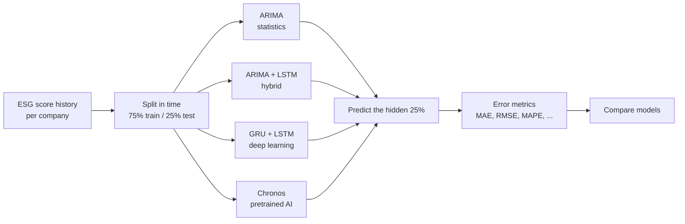
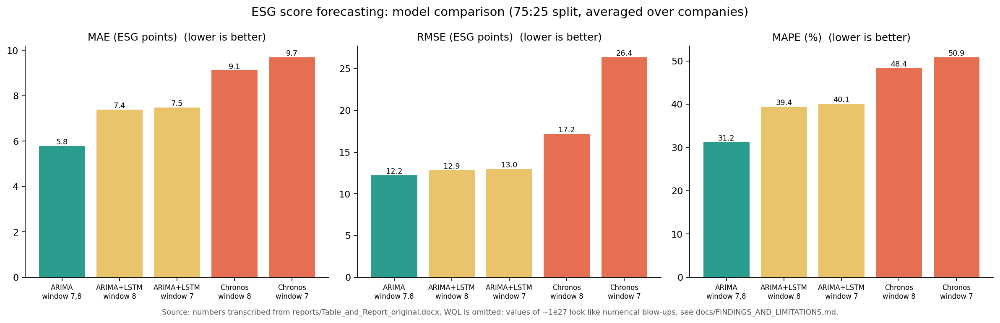

# 📈 ESG Score Forecasting: Statistical vs Deep Learning vs Foundation Model


> **One-sentence summary:** Can we predict how a company's **ESG score** will move in the future?
> This project compares four forecasting approaches, from a very simple statistical model to a pretrained AI model, on **495 companies** and finds out which one is most accurate.

---

## 1. The project in plain words

**ESG** stands for **E**nvironmental, **S**ocial and **G**overnance. Rating agencies give each company an ESG score (roughly 0 to 100). Investors use it to judge how responsibly a company is run.

**The question:** if we know a company's ESG scores up to now, can a model predict the next few scores?

**What I did:**
1. Took the ESG score history of **495 companies** (each identified by its stock ticker, such as `AAPL`). Companies with too little history are skipped when scoring.
2. For every company, used the **first 75%** of its history to teach/fit the model and **hid the last 25%** as the exam.
3. Asked each model to predict the hidden 25%, then measured how far off it was.
4. Compared four model families, from simple to complex.



## 2. The four models (easy explanations)

| # | Model | Type | Think of it as... |
|---|---|---|---|
| 1 | **ARIMA(0,1,0)** | Statistics | *"Next value ≈ the last value I saw."* A flat line. Simple, but a surprisingly tough opponent |
| 2 | **ARIMA + LSTM** (hybrid) | Statistics + Deep learning | ARIMA makes the main forecast, then an LSTM neural network tries to **fix the mistakes** ARIMA keeps making |
| 3 | **GRU + LSTM** | Deep learning | A neural network that **learns patterns** from the company's own past scores |
| 4 | **Chronos** (`amazon/chronos-t5-small`) | Foundation model | An AI model **already trained on huge numbers of time series**. It gets the last 7 or 8 scores and forecasts, with no training on ESG data |

**Window size (7 or 8)** = how many past scores the model looks at before predicting the next one.

## 3. Results

Numbers below come from the project report ([`reports/Table_and_Report_original.docx`](reports/Table_and_Report_original.docx)), averaged over companies, 75:25 split. **Lower is better.**

| Model | Window | MAE | RMSE | MAPE (%) |
|---|---:|---:|---:|---:|
| **ARIMA(0,1,0)** | 7 and 8 | **5.80** | **12.21** | **31.2** |
| ARIMA + LSTM | 8 | 7.39 | 12.86 | 39.4 |
| ARIMA + LSTM | 7 | 7.49 | 12.97 | 40.1 |
| Chronos | 8 | 9.11 | 17.17 | 48.4 |
| Chronos | 7 | 9.70 | 26.37 | 50.9 |



Full table (MSE, error rate, WQL) is in [`results/report_benchmark.csv`](results/report_benchmark.csv). Values printed by the notebooks are in [`results/notebook_outputs.csv`](results/notebook_outputs.csv).

### What the results say

- 🏆 **The simplest model won.** The flat-line ARIMA beat the neural networks and Chronos on every error measure in the report.
- **More complex did not mean better here.** Adding an LSTM to ARIMA made the forecast slightly *worse*, not better.
- **Likely reasons** (explanations to test, not proven facts): ESG scores change slowly, so "same as last time" is hard to beat; each company has a short history, and neural networks need lots of data to learn from.

> 💡 **Take-away:** before using a complicated model, always compare it with a simple baseline. If it can't beat the baseline, it isn't adding value.

## 4. Honest notes (read before quoting any number)

While organising the notebooks I checked them carefully. Being open about this is part of good research. Details and evidence are in [`docs/FINDINGS_AND_LIMITATIONS.md`](docs/FINDINGS_AND_LIMITATIONS.md).

| # | Finding | Why it matters |
|---|---|---|
| 1 | **The ESG dataset is not in this repo.** The notebooks read `PaperReady_numeric_esg.txt`, which was not available when the repo was built | Notebooks can't be re-run as is. See [`data/README.md`](data/README.md) |
| 2 | **Chronos notebooks slice the forecast along the wrong axis.** `predict()` returns *(series, samples, horizon)*, but the code takes `forecast[0, :, 0]` (or `.mean(dim=-1)`), which is not a forecast path | Chronos numbers should be treated as **provisional**. The fixed version is in `src/` and needs a re-run with the real data |
| 3 | The **GRU+LSTM notebook scales the full series** (train and test) before splitting | Small information leak. The clean code in `src/` fits the scaler on training data only |
| 4 | **"WQL" in the notebooks is MSE ÷ variance**, not the standard weighted quantile loss, and shows values around 10²⁶ to 10²⁷ for GRU+LSTM and the hybrid | Likely caused by near-constant test series. Not used for conclusions |
| 5 | **Chronos MSE differs between the report (295) and the notebook runs (700 to 740)** | MSE is dominated by a few outlier companies. The median is more reliable (see the benchmark script) |
| 6 | **Different models skip different companies** (hybrid/GRU: fewer than 20 observations, Chronos: fewer than 16, 84 skipped) | The clean benchmark uses **one rule for all models** so the comparison is fair |
| 7 | No ARIMA notebook was supplied, only its result in the report | The ARIMA baseline is re-implemented in `src/` |
| 8 | "Error rate" and "MAPE" are identical in every table | They are the same formula for non-negative scores |

## 5. What's inside the repository

```text
ESG-Forecasting-ML/
├── README.md
├── notebooks/                      # ORIGINAL research notebooks (kept unchanged)
│   ├── 01_arima_lstm_hybrid_original.ipynb
│   ├── 02_gru_lstm_original.ipynb
│   └── 03_chronos_original.ipynb
├── reports/
│   └── Table_and_Report_original.docx   # original report with the results table
├── src/esg_forecasting/            # clean, tested re-implementation
│   ├── data.py                     #   load / split / filter / synthetic demo data
│   ├── metrics.py                  #   MSE, MAE, RMSE, MAPE, Theil's U, Pearson, Bias
│   ├── models.py                   #   naive, ARIMA, ARIMA+LSTM, GRU+LSTM, Chronos
│   └── benchmark.py                #   one command that scores all models the same way
├── scripts/make_figures.py         # redraws the comparison chart
├── tests/                          # 24 automated tests
├── results/
│   ├── report_benchmark.csv        #   table from the report
│   ├── notebook_outputs.csv        #   numbers printed by the notebooks
│   ├── figures/model_comparison.png
│   └── demo_synthetic/             #   proof the pipeline runs (fake data, not results)
├── data/
│   ├── README.md                   #   expected data format
│   ├── sample/synthetic_esg_demo.txt   # SYNTHETIC demo data
│   └── raw/                        #   put your real ESG file here (git-ignored)
├── docs/
│   ├── HOW_IT_WORKS.md             #   methodology in simple language
│   ├── METRICS_EXPLAINED.md        #   every metric with a tiny example
│   ├── FINDINGS_AND_LIMITATIONS.md #   the checks behind section 4
│   └── INTERVIEW_GUIDE.md          #   60-second pitch + likely questions
├── requirements.txt / requirements-chronos.txt / pyproject.toml
└── LICENSE / CITATION.cff
```

**Original vs clean:** `notebooks/` keeps the original research code exactly as it was run. `src/` is a cleaned version with fixed seeds, scaling on training data only, one company filter for all models, and unit tests. It is **not** a re-run of the paper's numbers.

## 6. Run it yourself

```bash
git clone https://github.com/Saniya1312S/ESG-Forecasting-ML.git
cd ESG-Forecasting-ML
python -m venv .venv && source .venv/bin/activate     # Windows: .venv\Scripts\activate
pip install -r requirements.txt
pip install -e .

# 1. run the tests
pytest

# 2. run the demo benchmark on SYNTHETIC data (takes about a minute)
python -m esg_forecasting.benchmark \
  --data data/sample/synthetic_esg_demo.txt \
  --models naive arima arima_lstm gru_lstm \
  --epochs 5 --max-companies 8 --out results/demo_synthetic
```

**With your real ESG data** (format in [`data/README.md`](data/README.md)):

```bash
python -m esg_forecasting.benchmark --data data/raw/PaperReady_numeric_esg.txt \
  --models naive arima arima_lstm gru_lstm --window 8 --epochs 20 --out results/full_run
```

**Chronos** (optional, needs PyTorch and a model download):

```bash
pip install -r requirements-chronos.txt
python -m esg_forecasting.benchmark --data data/raw/PaperReady_numeric_esg.txt --models chronos --window 8 --out results/chronos_run
```

The benchmark writes `per_company_results.csv` and `summary.csv` (mean **and** median of each metric, plus how many companies succeeded or failed).

## 7. Metrics in one line each

| Metric | Plain meaning |
|---|---|
| **MAE** | Typical miss, in ESG points |
| **RMSE** | Like MAE but big misses count extra |
| **MSE** | RMSE squared |
| **MAPE** | Average miss as a % of the true score (unstable if scores are near 0) |
| **Theil's U** | 0 = perfect, 1 = worst (error compared with the size of the values) |
| **Bias** | Does the model usually guess too high (+) or too low (−)? |
| **Pearson** | Do predictions go up and down together with the real values? |

More with examples in [`docs/METRICS_EXPLAINED.md`](docs/METRICS_EXPLAINED.md).

## 8. Limitations and next steps

- [ ] Add the real ESG dataset (or a clear source and access instructions) and re-run everything with the clean pipeline
- [ ] Re-run Chronos with the corrected forecast slicing
- [ ] **Walk-forward validation** instead of one 75:25 split
- [ ] Add an explicit **"last value" baseline row** to the report table (ARIMA(0,1,0) is exactly that)
- [ ] Try ARIMA with drift, ETS and small tuned ARIMA orders as stronger statistical baselines
- [ ] Report **median** error next to the mean, plus confidence intervals
- [ ] Probabilistic forecasts (prediction intervals), not only single numbers
- [ ] Look at which companies or sectors are hardest to forecast
- [ ] ESG scores are provider-specific; results may not transfer to other rating agencies
- [ ] A forecast of an ESG score is **not** investment advice

## 9. Skills demonstrated

`Time-series forecasting` · `ARIMA / statsmodels` · `LSTM and GRU (Keras / TensorFlow)` · `Hybrid statistical + neural models` · `Foundation models for time series (Chronos)` · `Forecast evaluation (MAE, RMSE, MAPE, Theil's U, bias)` · `Train/test leakage awareness` · `Reproducible Python packaging` · `Unit testing (pytest)` · `Critical review of research code` · `Technical writing`

## 10. License and author

MIT License, see [LICENSE](LICENSE). Citation info in [CITATION.cff](CITATION.cff).

**Author:** [@Saniya1312S](https://github.com/Saniya1312S)
